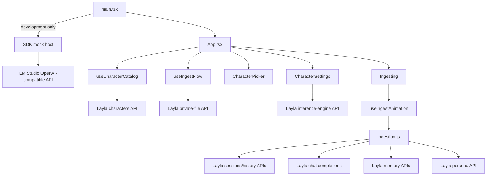
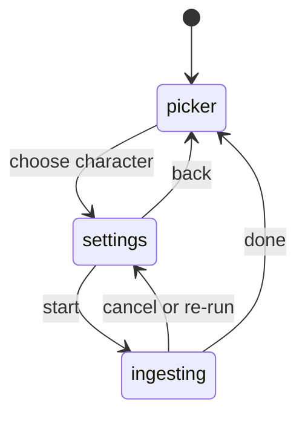

# Technical Deep Dive: LLM-based Long-term Memory

This guide explains how this mini-app turns Layla character conversations into
long-term memories and knowledge-graph data. It follows the production code
path, shows where each Layla SDK API fits, and calls out the operational
trade-offs that matter when extending or debugging the project.

The short version is:

1. Load a character and its settings from the Layla host.
2. Find the timestamp of that character's newest saved memory.
3. Page through newer chat sessions and messages.
4. Turn each session into overlapping three-message windows.
5. Ask Layla's selected inference engine to summarize every window.
6. Save each summary immediately as a Layla memory.
7. Ask the model to extract graph data from every non-empty summary.
8. Update the saved memory with the graph JSON and animate the graph in the UI.

The application is entirely client-side. In production it does not call an LLM
over HTTP and does not contain an API key. `@layla-network/sdk` sends requests
through the React Native WebView bridge injected by the Layla host.

## 1. Architecture at a glance



The project deliberately separates three concerns:

- Screens and components render state and dispatch user actions.
- React hooks own asynchronous lifecycle, cancellation, and screen state.
- Pure or mostly pure helpers in `ingestion.ts`, `promptTemplates.ts`, and
  `configFile.ts` implement the domain logic and SDK request shapes.

There is no routing library or global state manager. `App.tsx` creates one
`LaylaSDK` instance with `useMemo`, passes it into the feature hooks, and uses a
three-value `screen` state (`picker`, `settings`, or `ingesting`) as the router.

## 2. Runtime and build model

### Production inside Layla

The installed dependency is `@layla-network/sdk@0.1.28`. The application
constructs one client:

```ts
const layla = useMemo(() => new LaylaSDK(), []);
```

The client is not configured with a URL, token, or model. Its public resource
methods communicate with the Layla React Native host through the WebView
bridge. Conceptually, each SDK call follows this exchange:

```text
React component/hook
  -> Layla SDK resource method
  -> window.ReactNativeWebView.postMessage(...)
  -> Layla native host
  -> host response event
  -> SDK promise resolution
  -> React state update
```

If the production bundle is opened in an ordinary browser without a mock, the
bridge is absent and SDK calls fail with a bridge-unavailable SDK error.

Vite uses `vite-plugin-singlefile`. `npm run build` first runs the TypeScript
project build and then emits a WebView-friendly, self-contained `dist/index.html`.
Vite also copies these Layla import assets from `public/`:

- `app.json`: title, tagline, description, and asset references.
- `icon.jpg`: listing/import icon.
- `bg.jpg`: listing background.

Those files land at the root of `dist/`, which is the correct layout for a
packaged Layla mini-app. The resulting directory can be zipped without adding
an extra parent folder.

### Development in a normal browser

`main.tsx` checks `import.meta.env.DEV` before rendering and calls
`installDemoHost()`. This wraps the SDK's `installLaylaMock` with project data:

- synthetic Character Card V2 records;
- generated SVG portraits stored as data URIs;
- three mock chat sessions per character;
- an initially empty memory collection;
- mock timing for realistic latency;
- a custom completion responder backed by LM Studio.

The app itself still calls the same `LaylaSDK` methods. Only the host behind the
SDK changes, so local development exercises nearly the same integration path as
production.

The exception is model inference. `src/demo/lmStudio.ts` calls the local
OpenAI-compatible server at `http://localhost:1234/v1`:

1. If `VITE_LM_STUDIO_MODEL` is set, use that model ID.
2. Otherwise call `GET /models`, cache the first reported model, and use it.
3. Send non-streaming `POST /chat/completions` requests.
4. Return `choices[0].message.content` to the SDK mock.

The production bundle does not take this path because the demo host is guarded
by Vite's compile-time development flag.

## 3. Source map

| File | Responsibility |
| --- | --- |
| `src/main.tsx` | Installs the development host and mounts React. |
| `src/App.tsx` | Owns the single SDK client and selects the active screen. |
| `src/features/memoryIngest/useCharacterCatalog.ts` | Pages characters and hydrates portraits. |
| `src/features/memoryIngest/useIngestFlow.ts` | Screen state and per-character configuration lifecycle. |
| `src/features/memoryIngest/useIngestAnimation.ts` | Orchestrates the complete ingest run and its visual state. |
| `src/features/memoryIngest/ingestion.ts` | History loading, windowing, completions, memory drafts, and graph normalization. |
| `src/features/memoryIngest/promptTemplates.ts` | Loads persona context and renders prompt templates. |
| `src/features/memoryIngest/configFile.ts` | Reads and writes versioned `config.json` through Layla. |
| `src/libs/defensiveJsonParser.ts` | Repairs and schema-reconciles unreliable model JSON. |
| `src/demo/data.ts` | Mock characters, histories, memories, and SDK host setup. |
| `src/demo/lmStudio.ts` | Development-only model adapter. |

## 4. SDK surface used by the app

| SDK call | Where | Why |
| --- | --- | --- |
| `layla.characters.list(offset, range, options)` | `useCharacterCatalog` | Load character cards 12 at a time. |
| `layla.characters.getImage(id, options)` | `resolvePortrait` | Fetch a ready-to-render portrait source. |
| `layla.utils.readFile(name, options)` | `configFile.ts` | Read the mini-app's private `config.json`. |
| `layla.utils.saveFile(name, base64, share)` | `configFile.ts` | Persist all characters' settings without sharing. |
| `layla.chat.getInferenceEngines(options)` | `CharacterSettings` | Populate the engine selector. |
| `layla.chat.setInferenceEngine(name, options)` | `useIngestAnimation` | Select the engine before any completion request. |
| `layla.memories.list(characterId, 0, 1, options)` | `getLatestMemoryTimestamp` | Establish the incremental-ingest cutoff. |
| `layla.chat.getChatSessions(...)` | `loadNewTranscripts` | Page newest-first sessions. |
| `layla.chat.getChatHistory(...)` | `loadNewSessionMessages` | Page newest-first messages for each session. |
| `layla.personas.get(characterId, options)` | `loadPromptTemplateValues` | Resolve the character-specific user name and persona. |
| `layla.chat.completions.create(...)` | Summary and graph helpers | Run non-streaming local inference. |
| `layla.memories.createOrUpdate(memories, options)` | Ingest runner | Create summary memories, then update them with graph JSON. |

Every long-running ingest SDK call receives the same `AbortSignal`. Cancelling
the run therefore propagates through memory, history, persona, inference-engine,
completion, and memory-write requests rather than merely hiding the screen.

## 5. Character discovery and portraits

`useCharacterCatalog` starts loading as soon as `App` mounts. It requests pages
of 12 with an explicit offset. A full page means the UI tentatively exposes a
"Load more" action; a short page means the end has been reached.

Several refs protect this asynchronous flow:

- `offsetRef` tracks the next page boundary without waiting for a render.
- `isLoadingRef` prevents concurrent page requests.
- `hasMoreRef` prevents calls past the end.
- `generationRef` makes responses from a stale effect instance harmless.
- one `AbortController` cancels the catalog when the hook unmounts.

After a page arrives, portraits are fetched sequentially in the background.
This lets character cards appear before all image payloads have crossed the
bridge. Each successful image is stored both in a `portraits` lookup and in the
character card's `data.data.extensions.image` field via
`hydrateCharacterImage`.

`resolvePortrait` asks the host first. If no host image is available, it falls
back to an image already embedded in Character Card V2 extensions. The SDK
returns a ready-to-use image source, so the code assigns it directly to `` without adding another data-URI prefix.

The picker handles four states: first-page loading, first-page error, empty
catalog, and a populated paginated catalog. Portraitless cards use the first
letter of the character's name.

## 6. Screen and configuration state

`useIngestFlow` is the application's small state machine:



Selecting a character immediately opens settings with defaults, then
asynchronously loads that character's stored configuration. If another
character is selected before the read finishes, the old read is aborted and a
generation number prevents its result from overwriting the new selection.

### The private configuration file

Settings are stored in the mini-app's private Layla storage, not in browser
storage and not on the character card. The file shape is:

```json
{
  "version": 1,
  "characters": {
    "character-id": {
      "inferenceEngine": null,
      "summarySystem": "...",
      "summaryInstruction": "...",
      "graphSystem": "...",
      "graphInstruction": "..."
    }
  }
}
```

`readFile` may return either raw base64 or a data URI. `decodeText` strips any
prefix, converts the binary bytes, and uses `TextDecoder` so non-ASCII prompts
survive round trips. Saving performs the reverse with `TextEncoder` and sends
raw base64 to `saveFile`, as required by the SDK.

The parser normalizes each field independently. Missing or mistyped prompt
fields fall back to `DEFAULT_CONFIG`; an empty or invalid engine becomes
`null`, meaning the Layla default.

### Autosave and race control

Prompt changes are debounced by 500 ms. Saves are chained onto a promise queue,
which is important because every save performs a read-modify-write of the
shared `config.json`. Without serialization, two rapid writes could both read
the old file and one could overwrite the other.

The hook also tracks:

- the last successfully saved serialized configuration;
- the last attempted configuration, to avoid retrying an unchanged failure on
  every render;
- load and save generations, so stale completions cannot update status;
- explicit save attempts when the user leaves settings or starts ingesting.

The UI communicates `loading`, `saving`, `saved`, and `error` states. Starting
is disabled only while the initial configuration read is running.

## 7. Prompt construction

There are two independent prompt pairs:

- a summary system prompt plus summary instruction;
- a graph system prompt plus graph instruction.

The user instruction is appended after the current transcript window or
summary. The system prompts support six templates:

| Template | Source |
| --- | --- |
| `{{char}}` | `character.data.data.name` |
| `{{user}}` | `layla.personas.get(character.id).name` |
| `{{persona}}` | character-specific persona description |
| `{{character_card}}` | serialized Character Card V2 data |
| `{{description}}` | character-card description |
| `{{personality}}` | character-card personality |

Persona values are loaded once per ingest run, after transcript discovery and
before the first summary. The resulting template-value object is reused for all
windows, avoiding one bridge request per model call.

`renderSystemPrompt` has a compatibility-oriented behavior: if a customizable
system prompt omits a compact context template, the missing field is appended
as a context block before substitution. This means even old or heavily edited
prompts receive the character/persona basics. The full `{{character_card}}`
template is the exception: it is only substituted when the configured prompt
explicitly contains it, so the card JSON is opt-in.

When serializing the full character card, the portrait is replaced with
`[omitted from text prompt]`. Portrait data URIs can be several megabytes and
provide no useful textual context, so this avoids wasting the context window.

## 8. The ingest pipeline in detail

The entire run lives in one effect in `useIngestAnimation`. A `runRef` prevents
React Strict Mode's development effect behavior from starting concurrent runs,
and cleanup aborts the active controller.

### Step 1: select the inference engine

Settings first call `getInferenceEngines` to show the available names. At run
start the app calls:

```ts
await layla.chat.setInferenceEngine(config.inferenceEngine, { signal });
```

A string selects a named host engine. `null` resets to Layla's default. The app
checks the returned `success` flag and stops before reading or writing memories
if the engine cannot be selected.

The engine selection applies to subsequent chat completions in the host. This
app does not reset it at the end of a run.

### Step 2: determine the incremental cutoff

The app asks for one memory:

```ts
layla.memories.list(characterId, 0, 1, { signal });
```

Layla returns newest memories first, so the first memory's timestamp becomes
the cutoff. If there are no memories, the cutoff is zero and all available chat
history is eligible.

This makes repeated runs inexpensive: session and message scanning stops as
soon as data is no newer than the latest saved memory.

### Step 3: page sessions and history

Sessions are loaded 20 at a time. Although the SDK already specifies
newest-first results, each page is explicitly sorted by
`last_message_timestamp` descending before processing. When a session's last
message is at or before the cutoff, the outer scan stops.

For each eligible session, messages are loaded 50 at a time and similarly
sorted newest-first. The loader:

- stops at messages whose timestamp is at or before the cutoff;
- ignores blank content;
- continues paging while a full page is returned;
- finally sorts collected messages oldest-first for prompt construction.

Session boundaries are preserved. Windows never combine messages from two
different chat sessions, and every resulting memory keeps its source
`session_id`.

### Step 4: construct overlapping windows

The fixed `WINDOW_SIZE` is three messages. For a session with messages
`A B C D E`, the windows are:

```text
A B C
  B C D
    C D E
```

A one- or two-message session becomes one smaller window. Each line is rendered
as `speaker: content`; assistant entries fall back to the selected character's
name and user entries fall back to `user`. A window timestamp is the newest
message timestamp within that window.

Overlap retains local conversational continuity but intentionally duplicates
some source text across generated memories. For `M >= 3` messages in one
session, the app creates `M - 2` memories.

### Step 5: summarize and create memory records

Each window is processed sequentially with a non-streaming completion:

```ts
layla.chat.completions.create({
  messages: [
    { role: "system", content: renderedSummarySystemPrompt },
    { role: "user", content: rawText + "\n\n" + summaryInstruction }
  ],
  signal
});
```

The completion's first assistant message becomes `summary`. The app then
creates a `LaylaMemory` with `id: 0`, which tells the host to assign an ID:

```ts
{
  id: 0,
  character_id,
  session_id,
  rawText,
  timestamp,
  summary,
  knowledgeGraphJSON: null
}
```

The returned record is merged into the local draft so the host-assigned ID is
available for the update phase. Saving immediately gives summary generation
partial durability: if a later window fails, earlier summaries already exist
in Layla.

### Step 6: extract and normalize graph data

After all summaries have been created, the app enters a second sequential loop.
Empty summaries are skipped. Each other summary is sent to another non-streaming
completion with the graph system prompt and instruction.

The ideal response is an array of triples:

```json
[
  {
    "subject": "Mira",
    "relationship": "lives in",
    "object": "Glass Harbor"
  }
]
```

The code also accepts graph-shaped objects with `nodes`/`entities` and
`edges`/`relations`, plus common relation aliases:

- subject: `subject`, `from`, or `source`;
- relationship: `relationship`, `relation`, or `label`;
- object: `object`, `to`, or `target`.

The normalized/repair result is serialized into `knowledgeGraphJSON`. The app
then calls `createOrUpdate` with the existing positive memory ID, updating the
same memory created during summarization.

The internal `graphTriples` property is UI-only and is stripped by
`memoryPayload` before SDK writes, keeping the host payload exactly aligned with
the exported `LaylaMemory` shape.

### Step 7: visualize the graph

Graph rendering does not make additional SDK calls. Parsed entities are
deduplicated by normalized IDs, classified into `person`, `place`, `event`,
`trait`, or `object`, and positioned around the portrait with a deterministic
golden-angle-like layout. Relations are deduplicated by
`from|label|to` and rendered as SVG lines once both endpoint nodes exist.

If the model supplies explicit entity types, supported types are preserved.
Otherwise `inferKind` applies simple English keyword and capitalization
heuristics. Display data is capped at 28 entities and 40 relations per parsed
graph response to keep the mobile visualization manageable. The persisted JSON
is not replaced by these display limits.

Particles, delayed node insertion, and progress logs are presentation state;
they do not affect memory contents.

## 9. Defensive JSON parsing

Small local models frequently return JSON inside prose, Markdown fences, or
slightly invalid syntax. `defensiveJsonParser` is a general six-stage recovery
pipeline designed never to throw:

1. Extract fenced, balanced, truncated, and whole-text JSON candidates.
2. Try strict `JSON.parse` first.
3. Repair smart/single quotes, comments, unquoted keys, bare values,
   Python/JavaScript literals, trailing commas, missing commas, truncated
   strings, and unclosed brackets.
4. Reconcile schema keys using case/separator normalization and bounded
   Levenshtein matching.
5. Coerce schema types and apply defaults where configured.
6. Rank candidates by errors, schema fit, source quality, and length.

Graph extraction tries two schemas: a top-level triple array and a richer
display object. It scores usable results by the number of triples, entities,
and relations recovered, then keeps the strongest parse. If nothing useful can
be parsed, it persists `{"raw":"the model response"}` rather than losing the
model output. In that fallback case the visual graph is empty.

This parser is intentionally permissive: the graph prompt guides the model,
while the parser absorbs common deviations instead of making the entire ingest
fail because of formatting.

## 10. Cancellation, errors, and progress

One `AbortController` owns an ingest run. The controller's signal is passed to
SDK requests and to the custom abort-aware `sleep` helper used between visual
updates. Pressing cancel calls `abort()` before returning to settings. Effect
cleanup also aborts, covering unmounts and dependency changes.

`LaylaAbortError` is treated as an expected exit and does not add an error log.
Other errors are appended to the on-screen event log. The current screen does
not have a dedicated terminal error state or retry button; the user can cancel
back to settings and start again.

Overall progress is weighted rather than based on raw request count:

- reading: 12%;
- summarizing: 46%;
- graphing: 42%.

The weights reflect perceived work, not guaranteed runtime. Local inference
speed and prompt size usually dominate actual duration.

## 11. Persistence and retry semantics

Understanding the timestamp cutoff and two-write memory lifecycle is essential.

### Successful run

For every window, the final host record contains source text, summary, source
session, window timestamp, and graph JSON. A later run sees the newest of these
timestamps and scans only newer chat data.

### Failure during summarization

Windows saved before the failure remain in Layla. Their timestamps may advance
the next run's global cutoff. Depending on the ordering of sessions and window
timestamps, unsaved older windows can then be skipped on retry.

### Failure during graphing

All summary-only records already exist before graphing begins. Because they
advance the cutoff, rerunning the current implementation does not revisit those
windows merely to fill missing graph JSON. This is a partial-durability versus
retry-completeness trade-off in the present design.

### Global character cutoff

The cutoff is the newest memory timestamp for the character, not a per-session
watermark. This is simple and fast, but a newly discovered or delayed session
whose messages are older than that timestamp is not ingested.

For stronger resumability, a future version could save a separate ingest
checkpoint only after the complete run, track per-session watermarks, or query
for incomplete memories and resume graph enrichment before scanning new chat.

## 12. Cost and performance model

Let `W` be the number of transcript windows and `S` the number with non-empty
summaries. A normal run performs approximately:

- one inference-engine selection;
- one latest-memory query;
- one persona query;
- paginated session and history reads;
- `W + S` chat completions;
- `W` memory creates;
- `S` memory updates.

When every summary is non-empty, that is two model calls and two memory writes
per window. All windows and graph calls are sequential. This reduces load on an
on-device model, makes progress deterministic, and avoids concurrent host
writes, at the cost of throughput.

Every system prompt receives compact character and persona context. A textual
Character Card V2 serialization is included only when the configured prompt
explicitly uses `{{character_card}}`; its image payload is removed, but long
cards can still substantially increase prompt size when enabled.

The current app uses non-streaming completions because it consumes only final
summary/JSON outputs. The UI remains responsive through phase logs and progress
animation, though it cannot show token-level output. A streaming refactor could
use `layla.chat.completions.stream`, but would need to accumulate final content
before parsing and writing the memory.

## 13. Data and security boundaries

In production, character cards, persona text, histories, prompts, generated
summaries, graph data, and settings stay within the mini-app-to-Layla bridge
path. There is no production HTTP inference endpoint in this repository.

In development, the mock forwards prompts and mock conversation content to the
locally configured LM Studio server at `localhost`. The selected model name is
embedded into the development request, and browser CORS must allow the local
origin.

The configuration file is private mini-app storage. `saveFile` is called with
`share: false`, so the app does not invoke the native share flow.

## 14. Important extension points

### Change windowing behavior

Edit `WINDOW_SIZE` and `buildTranscriptWindows` in `ingestion.ts`. If moving to
token-based windows, preserve session IDs and use the newest included message as
the memory timestamp so incremental scanning remains coherent.

### Change memory content

Update `makeMemoryDraft` and `memoryPayload` together. `memoryPayload` is the
boundary that ensures only SDK-supported `LaylaMemory` fields reach the host.

### Change prompt context

Add a field to `PromptTemplateValues`, `PROMPT_TEMPLATE_FIELDS`,
`TEMPLATE_PATTERN`, and `createPromptTemplateValues`. If the value requires a
host request, load it once per run rather than once per window.

### Accept another graph format

Extend the two JSON schemas and the alias logic in `parseGraphTriples`,
`parseGraphEntities`, and `parseGraphRelations`. Keep persisted source data and
display normalization separate so UI constraints do not silently truncate the
stored graph.

### Add streaming completions

Replace `completions.create` with `completions.stream`, attach content and error
handlers, and await `finalContent()`. Keep the existing abort signal or call the
stream's `abort()` during cleanup. Graph parsing must run only after the final
content is complete.

### Improve recovery

The highest-value reliability extension is an explicit run/checkpoint model.
A robust approach would:

1. discover and record the exact candidate window IDs;
2. make memory creation idempotent with a deterministic source key;
3. mark summary and graph stages independently;
4. resume incomplete stages before advancing a committed watermark.

## 15. Practical debugging checklist

### Characters do not load

- Confirm the app is inside Layla or the development mock was installed before
  the first SDK call.
- Inspect the first `characters.list` failure shown by the picker.
- Check that stale requests are not being aborted by a remount.

### Portraits are blank

- Verify `characters.getImage` returns a complete source string.
- Check `data.data.extensions.image` for the fallback.
- Do not prepend a second `data:` prefix.

### Settings do not persist

- Inspect `readFile("config.json")` and `saveFile` results.
- Remember that saves are debounced and queued.
- Validate that returned `content_base64` is valid base64 or a valid data URI.

### Ingest immediately says there is no new history

- Inspect the newest saved memory timestamp.
- Compare it with each session's `last_message_timestamp`.
- Remember that the cutoff is global per character and uses `<=` comparisons.

### Graphs are empty

- Inspect the raw completion saved under `knowledgeGraphJSON`.
- Check whether the summary was empty; empty summaries bypass graph inference.
- Test the output against the accepted aliases and container shapes.
- Review parser warnings in a debugger; the UI currently does not display them.

### Local completions fail

- Start LM Studio's server on port 1234 and load a chat model.
- Allow requests from the Vite browser origin.
- Set `VITE_LM_STUDIO_MODEL` if the first `/models` entry is not the desired
  model, then restart Vite.

## 16. Verification and packaging

Use the repository scripts as the release gate:

```bash
npm run lint
npm run build
```

Then verify `dist/` contains `index.html`, `app.json`, `icon.jpg`, and `bg.jpg`
at its root. For a real integration test, import that output into Layla and
exercise one character through all three phases, including cancellation and a
second run with no new messages.

## 17. End-to-end mental model

The key design idea is that Layla is both the data source and the durable sink.
The mini-app does not maintain its own conversation or memory database. It
temporarily transforms host-owned chat history into host-owned memory records:

```text
Layla character + persona
        +
Layla chat sessions/history
        |
        v
overlapping transcript windows
        |
        v
Layla completion: durable summary
        |
        v
Layla memory create
        |
        v
Layla completion: graph extraction
        |
        v
Layla memory update with knowledgeGraphJSON
```

React provides the workflow and visualization, while the SDK supplies the
runtime boundary for character data, local model inference, private files, and
long-term memory persistence. That division is what lets the same application
run against a browser mock during development and the real on-device Layla host
in production without changing the feature code.
